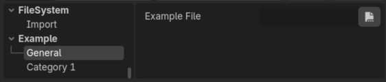
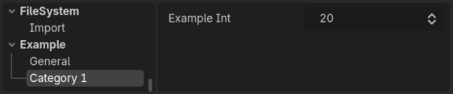

# UG Settings

## Overview

This addon contains a base class for streamlined project settings configuration and access.

Godot's default API is rather clunky with it's string-based project settings, and it can get quite confusing.

With this addon you can define and access custom project settings as regular and auto-completed object porperties.

You do so with ease by writing an intuitive script with the project settings you want to create as regular properties.

Additionally, the values are cached on the instances of settings objects, so fetching them would be faster than repeated `ProjectSettings.get_setting()` calls.

These settings object instances also react to external modifications to project settings, so you can still modify them regularly through other means, and not worry about syncing them yourself. There is a small caveat with that, which I am explaining more about [**below**](#small-caveat).


## Installation

Simply download the latest release and add the script `addons/ug_settings/plugin_settings.gd` anywhere in your project.


## How to use

### Create the script

Create a new tool script, and make sure it extends the `UgPluginSettings` class.

```gdscript
@tool
class_name ExampleSettings
extends UgPluginSettings
```

By default the settings you define will be added under the `Plugins` section in your project settings, but you can define a custom section by defining a constant named `SETTINGS_PATH`:

```gdscript
const SETTINGS_PATH: String = "Example"
```

By default the settings you define will be added under the `Genesal` category under the section in your project settings, but you can define a custom category for blocks of properties with `@export_category()`:

```gdscript
@export_category("Category 1")
```

To define a setting, simply define an exported variable of the desired type and default value the way you would otherwise do for a regular property, and then define a minimal setter for it like so:

```gdscript
@export var variable_name: Type = default_value:
    set(value):
        variable_name = value

        _property_set("variable_name", value)
```

Crucial:

1. Always use export variables.
2. you must use `_property_set` and match the string to the name of the variable.

You are now done setting up the script, here is a complete example:

```gdscript
@tool
class_name ExampleSettings
extends UgPluginSettings

const SETTINGS_PATH: String = "Example"


@export_file("*.tres") var example_file: String:
	set(value):
		example_file = value
		
		_property_set("example_file", value)

@export_category("Category 1")

@export var example_int: int = 20:
	set(value):
		example_int = value
		
		_property_set("example_int", value)
```

And it results in these project settings being created:



### Instantiate the object

Now, this is a very open ended requirement and you can approach it in multiple ways. The general idea is that you want to instantiate the script at least once at some point inside the editor so that settings are automatically generated.

In addition you also want access to the instantiated object so that you can use it wherever you need, so the simplest way to do this is with a static variable on scripts that would use it:

```gdscript
@tool
class_name TestResource
extends Resource

static var example_settings: ExampleSettings = ExampleSettings.new()
```

### Use the object

Then you can start using it like a normal object:

```gdscript
func _test() -> void:
	print(example_settings.example_int)
	
	example_settings.example_int = 5
```

Note that in the editor, setting the property would modify the corresponding project setting and in the editor would also automatically save the change.

## Small Caveat

This is about external modifications to project settings, meaning changes to settings via `ProjectSettings.set_setting()` or with **a different instance** of the same settings object type.

The way the object knows to update its values following a change to project settings is via the `ProjectSettings.setting_changed` signal. This signal is called at the end of the frame, meaning only on the next frame would the modifications be reflected on the object.

So this code:

```gdscript
@tool
class_name TestResource
extends Resource

static var example_settings: ExampleSettings = ExampleSettings.new()


@export_tool_button("test") var test = _test


func _test() -> void:
	example_settings.example_int = 5
	
	var new_settings: ExampleSettings = ExampleSettings.new()
	
	print(new_settings.example_int)
	
	new_settings.example_int = 7
	
	print(new_settings.example_int)
	
	print(example_settings.example_int)
	
	await RenderingServer.frame_post_draw
	
	print(example_settings.example_int)
```

outputs this:

```
5
7
5
7
```

This is not an issue if you only have one settings object instance and you work exclusively through it to get and set your project settings, or if you simply don't care to wait another frame.